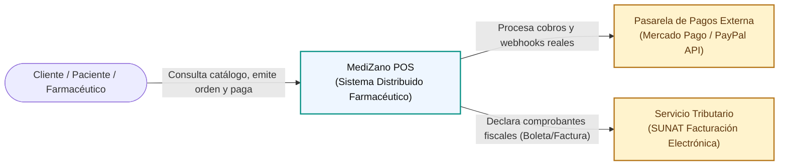

# MediZano POS - Microservicios Farmacéuticos 2026-2

Curso de **Desarrollo de Aplicaciones Distribuidas** (DIST), UPeU 2026-2.

**MediZano POS** es una plataforma integral de Punto de Venta (POS) y Gestión Farmacéutica construida bajo una **arquitectura distribuida de microservicios nativa de la nube**, contenerizada con Docker, descubrimiento dinámico con Eureka, seguridad reactiva perimetral y distribuida con JWT / Keycloak, frontend en Angular 17 sobre Nginx, mensajería asíncrona con Apache Kafka, consistencia mediante Saga Coreografiada y observabilidad completa con Actuator, Micrometer, Prometheus, Loki y Grafana.

---

## 1. Producto del Curso

El producto final corresponde al **Producto de Unidad 3**:

```text
Sistema distribuido de microservicios farmacéuticos end-to-end, configurable,
escalable, seguro, resiliente, consistente, observable, integrado con frontend
y defendido técnicamente.
```

### Resultado Esperado
Al finalizar el ciclo, el equipo sustenta un sistema distribuido farmacéutico real y reproducible en desarrollo y producción local. Cada integrante del equipo evidencia y defiende su aporte individual mediante **2 microservicios asignados (uno transaccional y uno no transaccional)**.

---

## 2. Contenido Curricular y Capacidades

### Unidad 1: Sistema Distribuido Base Orientado a Producción
* **S1:** Construcción del servicio base REST (`catalogo-ms`, JPA, Swagger, Actuator).
* **S2:** Configuración centralizada de ambientes (`config-server` + `config-repo/`).
* **S3:** Registro, descubrimiento y ejecución concurrente (`eureka-server`).
* **S4:** Punto único de acceso y distribución de tráfico (`api-gateway`).
* **S5:** Integración del sistema base y evaluación de la Unidad I.

### Unidad 2: Sistema Distribuido Robusto
* **S6:** Comunicación síncrona resiliente con OpenFeign + Resilience4j (`orden-ms` $\rightarrow$ `catalogo-ms` e `inventario-ms`).
* **S7 / S07b:** Seguridad distribuida y control de acceso RBAC con JWT asimétrico / Keycloak validado en cada microservicio.
* **S8:** Mensajería asíncrona desacoplada con Apache Kafka (`orden.creada` $\rightarrow$ `pago.validado`).
* **S9:** Consistencia eventual, compensación de inventario y consumidores idempotentes (Saga Coreografiada).
* **S10:** Observabilidad centralizada: correlación de logs con `traceId` (MDC/Alloy/Loki) y métricas en Prometheus/Grafana.
* **S11:** Integración frontend: SPA Angular consumiendo únicamente a través del Gateway con Guards y PKCE.
* **S12:** Integración y evaluación de la Unidad II.

### Unidad 3: Validación, Estabilización y Despliegue
* **S13 - S14:** Pruebas end-to-end y estabilización de contenedores Docker.
* **S15 - S16:** Sustentación final del sistema distribuido completo.

---

## 3. Arquitectura del Sistema (Diagramas C4)

### Nivel 1: Contexto del Sistema (System Context - C4)



---

### Nivel 2: Contenedores (Container Diagram - C4)

```mermaid
flowchart TD
    ClienteWeb["Frontend Angular 17 (Nginx :4200)"]
    
    subgraph Infraestructura["Infraestructura Spring Cloud"]
        Gateway["API Gateway (:8090)"]
        Eureka["Eureka Discovery (:8761)"]
        ConfigSrv["Config Server (:8888)"]
    end

    subgraph Seguridad["Seguridad & Identidad"]
        UsuarioMS["usuario-ms (:8087)\n(JWT / Keycloak)"]
    end

    subgraph MicroserviciosNegocio["Microservicios de Negocio"]
        CatalogoMS["catalogo-ms (:8081)\n(Medicamentos & Categorías)"]
        ClienteMS["cliente-ms (:8084)\n(Pacientes & DNI/RUC)"]
        OrdenMS["orden-ms (:8082)\n(Órdenes de Venta POS)"]
        PagoMS["pago-ms (:8083)\n(Pagos MercadoPago/PayPal)"]
        InventarioMS["inventario-ms (:8085)\n(Kardex, Lotes & Vencimiento)"]
        FacturacionMS["facturacion-ms (:8086)\n(Comprobantes Fiscales)"]
        ProveedorMS["proveedor-ms (:8088)\n(Laboratorios & Proveedores)"]
    end

    subgraph EventBroker["Mensajería Asíncrona"]
        Kafka["Apache Kafka (:19092)\nTopics: orden-eventos, pago-eventos"]
        KafkaUI["Kafka UI (:18085)"]
    end

    subgraph Observabilidad["Suite de Observabilidad"]
        Prometheus["Prometheus (:9090)"]
        Loki["Loki (:3100)"]
        Grafana["Grafana Dashboards (:3000)"]
    end

    ClienteWeb -->|HTTP /api/| Gateway
    Gateway -->|Enruta vía Eureka| UsuarioMS & CatalogoMS & ClienteMS & OrdenMS & PagoMS & InventarioMS & FacturacionMS & ProveedorMS

    OrdenMS -->|OpenFeign Síncrono Resiliente| CatalogoMS & InventarioMS
    OrdenMS -->|Publica orden.creada| Kafka
    Kafka -->|Consume orden.creada| PagoMS
    PagoMS -->|Publica pago.validado / pago.fallido| Kafka
    Kafka -->|Consume pago.validado| OrdenMS & FacturacionMS
    Kafka -->|Consume pago.fallido (Compensación)| OrdenMS

    MicroserviciosNegocio -.->|Scrape /actuator/prometheus| Prometheus
    MicroserviciosNegocio -.->|Logs con TraceID| Loki
    Prometheus & Loki -.-> Grafana
```

---

## 4. Mapa de Puertos y Servicios en Desarrollo (DEV)

| Componente | Tipo | Puerto Host | Descripción |
| :--- | :--- | :--- | :--- |
| **`config-server`** | Infraestructura | `8888` / `18888` | Config Server centralizado. |
| **`eureka-server`** | Infraestructura | `8761` | Registro y descubrimiento de servicios. |
| **`api-gateway`** | Infraestructura | `8090` / `18080` | Punto único de entrada perimetral con filtro JWT. |
| **`frontend`** | Cliente Web | `4200` | Single Page Application en Angular 17 + Nginx. |
| **`usuario-ms`** | Negocio (No Transaccional) | `8087` | Autenticación, JWT, roles y perfiles. |
| **`catalogo-ms`** | Negocio (No Transaccional) | `8081` | Medicamentos, principios activos y categorías. |
| **`cliente-ms`** | Negocio (No Transaccional) | `8084` | Pacientes, datos de contacto y validación DNI/RUC. |
| **`proveedor-ms`** | Negocio (No Transaccional) | `8088` | Laboratorios fabricantes y contratos de suministro. |
| **`orden-ms`** | Negocio (Transaccional) | `8082` | Venta POS y Carrito (Cabecera y Detalle). |
| **`pago-ms`** | Negocio (Transaccional) | `8083` | Cobro con pasarela externa (Mercado Pago / PayPal). |
| **`inventario-ms`** | Negocio (Transaccional) | `8085` | Movimientos Kardex, lotes y vencimientos de medicinas. |
| **`facturacion-ms`** | Negocio (Transaccional) | `8086` | Boletas y Facturas electrónicas SUNAT. |
| **`kafka`** | Broker de Eventos | `19092` | Clúster Apache Kafka para eventos de negocio. |
| **`kafka-ui`** | Monitoreo Kafka | `18085` | Consola web para inspección de topics y lag. |
| **`prometheus`** | Observabilidad | `9090` | Recolección de métricas de Actuator. |
| **`loki`** | Observabilidad | `3100` | Motor centralizado de almacenamiento de logs. |
| **`grafana`** | Observabilidad | `3000` | Tableros interactivos de métricas y trazabilidad. |

---

## 5. Regla de Reparto por Integrante (Equipo de 4 Integrantes)

Cumpliendo con la directiva oficial del sílabo (**2 microservicios por persona: 1 transaccional y 1 no transaccional**):

1. **Kenyi Calsin:** **`orden-ms`** (Transaccional) + **`cliente-ms`** (No transaccional).
2. **Aldo Calla:** **`inventario-ms`** (Transaccional) + **`catalogo-ms`** (No transaccional).
3. **Igarlos Mamani:** **`pago-ms`** (Transaccional) + **`usuario-ms`** (No transaccional).
4. **Juan Chambilla:** **`facturacion-ms`** (Transaccional) + **`proveedor-ms`** (No transaccional).

