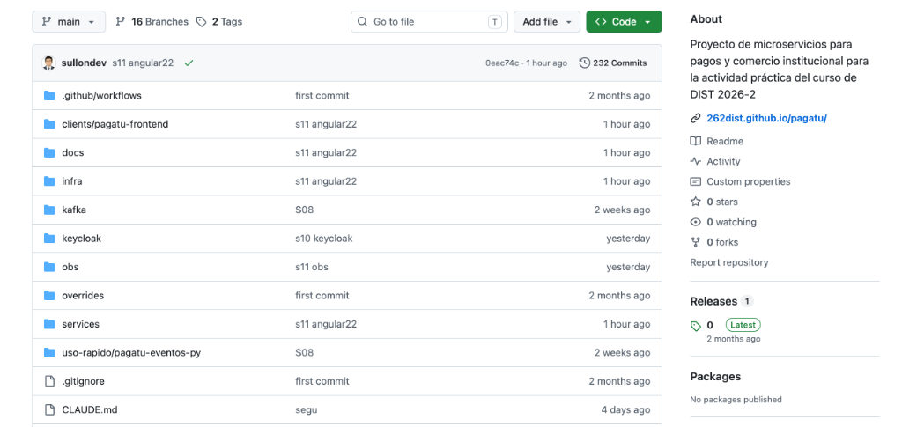
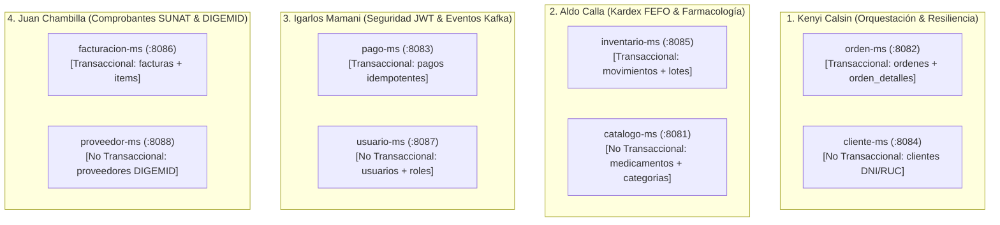
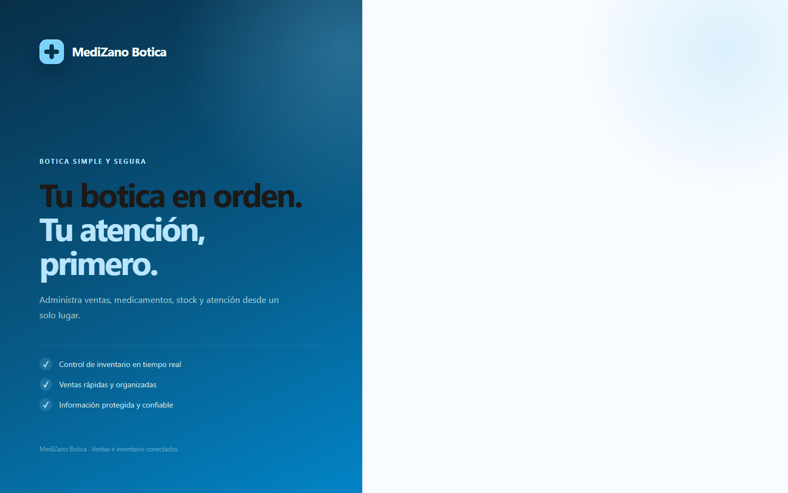
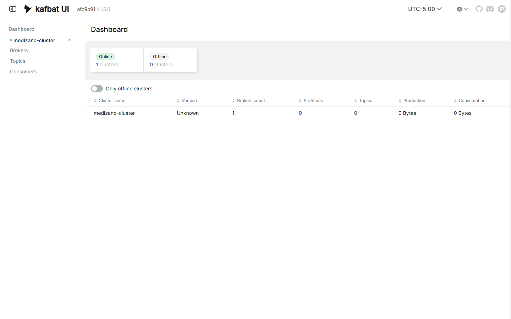
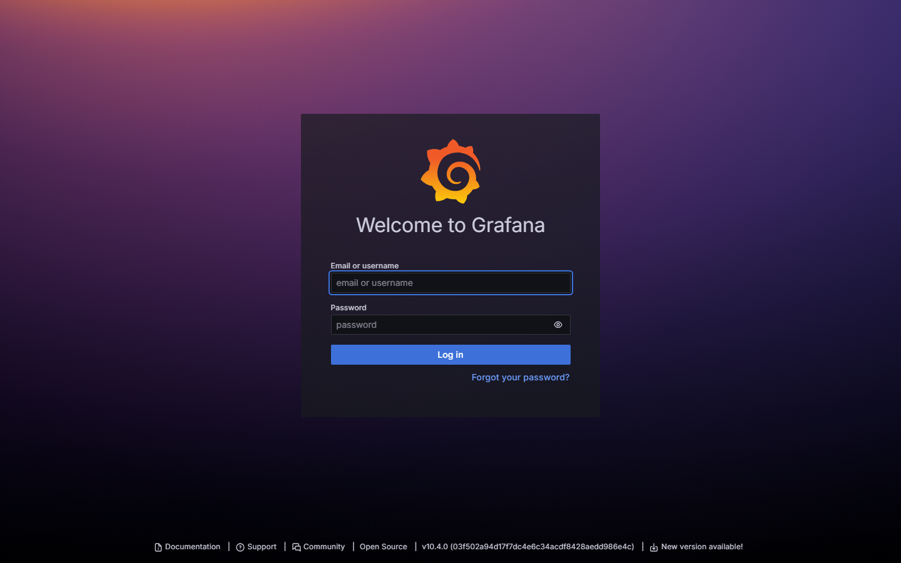
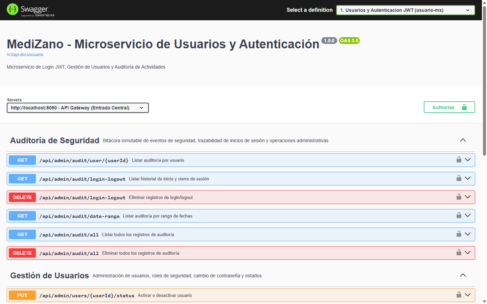
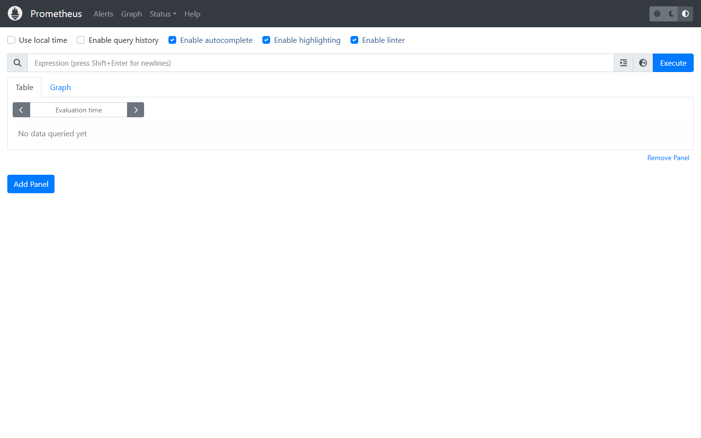
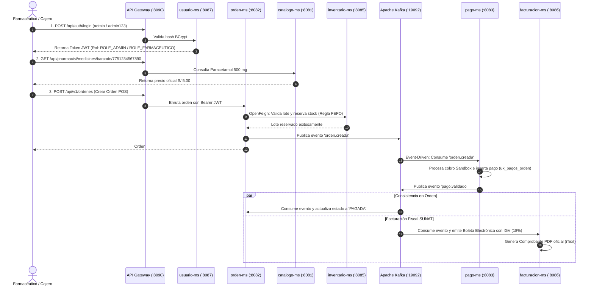

# MediZano POS - Sistema Distribuido Farmacéutico

> **Curso:** Desarrollo de Aplicaciones Distribuidas (DIST) · **Periodo:** 2026-2 · **Institución:** UPeU  
> **Repositorio Oficial:** [https://github.com/rbn-69-cod/MediZano_microservicios](https://github.com/rbn-69-cod/MediZano_microservicios)

---

> [!IMPORTANT]
> ### 🚀 Tablero de Enlaces Directos en Vivo (1-Click Demo)
> Durante la sustentación, abre directamente cualquiera de las interfaces operativas:
> 
> * 🛒 **Frontend Web POS (Angular 17):** [http://localhost:4200/](http://localhost:4200/)
> * 📑 **Swagger UI Centralizado (API Gateway):** [http://localhost:8090/swagger-ui.html](http://localhost:8090/swagger-ui.html)
> * 🔭 **Eureka Service Discovery:** [http://localhost:8761/](http://localhost:8761/)
> * 📨 **Kafka UI (Broker KRaft & Topics):** [http://localhost:18085/](http://localhost:18085/)
> * 📊 **Grafana Dashboards:** [http://localhost:3000/](http://localhost:3000/) *(Credenciales: `admin` / `admin`)*
> * 📈 **Prometheus Server:** [http://localhost:9090/](http://localhost:9090/)
> * 🎤 **Guía Detallada de Exposición (Minuto a Minuto):** [Abrir Guía de Sustentación](proyecto-sello/guia-exposicion.md)

---

## 🏛️ Repositorio Oficial GitHub & Estructura Distribuida

* 🐙 **URL de Origen:** [https://github.com/rbn-69-cod/MediZano_microservicios.git](https://github.com/rbn-69-cod/MediZano_microservicios.git)
* **Rama Principal:** `main` | **Arquitectura:** Clúster de Microservicios Contenerizados con Docker Compose



---

## 👥 Reparto Oficial por Integrante (4 Integrantes x 2 Microservicios)

Cumpliendo con la directiva de la cátedra (**1 microservicio Transaccional Cabecera-Detalle + 1 microservicio No Transaccional Catálogo/Maestro por estudiante**):



---

### 1️⃣ Integrante 1: Kenyi Calsin
**Rol:** Arquitectura de Orquestación de Pedidos y Resiliencia Síncrona.

* **Microservicio Transaccional:** `orden-ms` (Puerto `:8082` | BD: `medizano_ordenes_db`)
    * **Tablas implementadas:** `ordenes` (Cabecera: ID, cliente, método pago, estado, total) y `orden_detalles` (Detalle: ID, orden_id, medicamento_id, cantidad, precio, subtotal).
    * **Endpoints clave:** `POST /api/v1/ordenes` (Creación de venta POS), `GET /api/v1/ordenes/{id}`.
    * **Técnica defensiva:** Comunicación síncrona mediante **OpenFeign** hacia `catalogo-ms` e `inventario-ms` protegida con **Resilience4j Circuit Breaker y Timeouts (2s)**.
    * **Evento Kafka:** Emite el evento asíncrono `orden.creada` al topic `orden-eventos`.
* **Microservicio No Transaccional:** `cliente-ms` (Puerto `:8084` | BD: `medizano_clientes_db`)
    * **Tablas implementadas:** `clientes` (ID, tipo_persona, DNI, RUC, nombre_completo, teléfono, email, dirección).
    * **Endpoints clave:** `GET /api/v1/clientes/documento/{doc}`, `POST /api/v1/clientes`.
* **Qué responder ante el profesor:** *"Explico cómo `orden-ms` no hace JOINs con clientes ni medicamentos (Database per Service); valida los datos con OpenFeign y si el servicio catálogo falla, el Circuit Breaker de Resilience4j ejecuta el fallback sin tumbar la pasarela POS"*.

---

### 2️⃣ Integrante 2: Aldo Calla
**Rol:** Control de Inventario Kardex FEFO y Catálogo Farmacéutico.

* **Microservicio Transaccional:** `inventario-ms` (Puerto `:8085` | BD: `medizano_inventario_db`)
    * **Tablas implementadas:** `lotes` (lote, fecha_vencimiento, stock_actual, precio_compra) y `movimientos_inventario` (tipo: ENTRADA, SALIDA_VENTA, COMPENSACION, DEVOLUCION).
    * **Endpoints clave:** `POST /api/pharmacist/batches`, `GET /api/pharmacist/batches/medicine/{id}`, `POST /api/v1/inventario/reservar`.
    * **Técnica defensiva:** Algoritmo **FEFO (First Expired, First Out)** que selecciona automáticamente el lote con fecha de caducidad más cercana para la dispensación farmacéutica.
    * **Compensación Saga:** Endpoint de liberación y reposición de stock ante fallos de pago.
* **Microservicio No Transaccional:** `catalogo-ms` (Puerto `:8081` | BD: `medizano_catalogo_db`)
    * **Tablas implementadas:** `medicamentos` (nombre, principio activo, concentración, forma, código de barras) y `categorias` (Analgésicos, Antibióticos, etc.).
    * **Endpoints clave:** `GET /api/pharmacist/medicines`, `GET /api/pharmacist/medicines/barcode/{barcode}`.
* **Qué responder ante el profesor:** *"En una farmacia la regla crítica es FEFO, no FIFO. Si un lote vence antes, se descuenta primero. Si la orden se cancela, `inventario-ms` ejecuta una compensación restaurando el stock exacto al lote reservado"*.

---

### 3️⃣ Integrante 3: Igarlos Mamani
**Rol:** Seguridad Distribuida (JWT/RBAC), Pasarelas de Pago y Mensajería Kafka.

* **Microservicio Transaccional:** `pago-ms` (Puerto `:8083` | BD: `medizano_pagos_db`)
    * **Tablas implementadas:** `pagos` (ID, orden_id, transaction_id, gateway: PAYPAL/MERCADOPAGO, monto, estado).
    * **Endpoints clave:** `POST /api/v1/pagos/checkout`, `POST /api/v1/pagos/webhook/mercadopago`.
    * **Técnica defensiva:** **Consumidor Kafka Idempotente**. Protección con `CONSTRAINT uk_pagos_orden UNIQUE (orden_id)` para asegurar que ningún pedido se cobre dos veces ante reintentos de red.
    * **Evento Kafka:** Consume `orden.creada` y emite `pago.validado` o `pago.fallido`.
* **Microservicio No Transaccional:** `usuario-ms` (Puerto `:8087` | BD: `medizano_usuarios_db`)
    * **Tablas implementadas:** `usuarios` (username, password_hash BCrypt, email, activo) y `roles` (`ROLE_ADMIN`, `ROLE_FARMACEUTICO`, `ROLE_CLIENTE`).
    * **Endpoints clave:** `POST /api/auth/login`, `GET /api/admin/audit/all`.
* **Qué responder ante el profesor:** *"Demuestro que la seguridad no es solo de Gateway. Cada microservicio valida criptográficamente el JWT con su clave secreta y aplica `@PreAuthorize`. Además `pago-ms` tiene idempotencia garantizada por base de datos"*.

---

### 4️⃣ Integrante 4: Juan Chambilla
**Rol:** Facturación Electrónica Fiscal SUNAT y Gestión de Proveedores DIGEMID.

* **Microservicio Transaccional:** `facturacion-ms` (Puerto `:8086` | BD: `medizano_facturacion_db`)
    * **Tablas implementadas:** `facturas` (serie, correlativo, DNI/RUC, subtotal, IGV 18%, total, hash SUNAT) y `factura_items` (items facturados, descripción, IGV).
    * **Endpoints clave:** `POST /api/v1/facturas`, `GET /api/v1/facturas/{id}/pdf` (Generación de PDF con iText), `GET /api/v1/facturas/reportes/ventas`.
    * **Técnica defensiva:** Desacople por eventos: Al confirmarse el pago en Kafka, emite el comprobante electrónico fiscal con cálculo legal de IGV 18% y PDF descargable en tiempo real.
* **Microservicio No Transaccional:** `proveedor-ms` (Puerto `:8088` | BD: `medizano_proveedores_db`)
    * **Tablas implementadas:** `proveedores` (RUC, razón social, laboratorio, registro DIGEMID, teléfono, estado).
    * **Endpoints clave:** `GET /api/v1/proveedores`, `POST /api/v1/proveedores`.
* **Qué responder ante el profesor:** *"La facturación no bloquea la compra en caja. Cuando Kafka notifica `pago.validado`, `facturacion-ms` genera la Boleta o Factura electrónica con desglose de IGV oficial y emite el PDF mediante la librería iText"*.

---

## 📸 Galería Visual de Evidencias en Vivo

### 1. Sistema Web POS Farmacéutico (Frontend Angular 17 sobre Nginx)
Interfaz completa de dispensación, búsqueda de medicamentos por código de barras, selección de paciente y cobro digital:


---

### 2. Service Discovery (Netflix Eureka Server)
Las 8 instancias de microservicios registradas dinámicamente con sus IPs y puertos internos:


---

### 3. Broker Apache Kafka & Consola Kafka UI
Topics de mensajería asíncrona (`orden-eventos`, `pago-eventos`, `inventario-eventos`, `factura-eventos`) con particiones KRaft:


---

### 4. Suite de Observabilidad Unificada (Grafana)
Tableros de métricas JVM, throughput de peticiones HTTP, estado de base de datos y trazabilidad de logs con `traceId`:


---

### 5. API Gateway Centralizado & Swagger UI Interactivo
Punto único perimetral con documentación interactiva OpenAPI 3.0 de todos los microservicios:


---

### 6. Servidor de Series Temporales Prometheus
Scraping continuo de métricas en los endpoints `/actuator/prometheus` de cada contenedor:


---

## 🏛️ Arquitectura del Sistema (Diagramas C4)

### C4 Nivel 1: Contexto del Sistema (System Context)


---

### C4 Nivel 2: Diagrama de Contenedores (Container Diagram)
```mermaid
flowchart TD
    ClienteWeb["Frontend Angular 17 (Nginx :4200)"]
    
    subgraph Infraestructura["Infraestructura Spring Cloud"]
        Gateway["API Gateway (:8090)"]
        Eureka["Eureka Discovery (:8761)"]
    end

    subgraph Seguridad["Seguridad & Identidad"]
        UsuarioMS["usuario-ms (:8087)\n(Igarlos Mamani)"]
    end

    subgraph MicroserviciosNegocio["Microservicios de Negocio"]
        CatalogoMS["catalogo-ms (:8081)\n(Aldo Calla)"]
        ClienteMS["cliente-ms (:8084)\n(Kenyi Calsin)"]
        OrdenMS["orden-ms (:8082)\n(Kenyi Calsin)"]
        InventarioMS["inventario-ms (:8085)\n(Aldo Calla)"]
        PagoMS["pago-ms (:8083)\n(Igarlos Mamani)"]
        FacturacionMS["facturacion-ms (:8086)\n(Juan Chambilla)"]
        ProveedorMS["proveedor-ms (:8088)\n(Juan Chambilla)"]
    end

    subgraph EventBroker["Mensajería Asíncrona"]
        Kafka["Apache Kafka (:19092)\nTopics: orden-eventos, pago-eventos"]
        KafkaUI["Kafka UI (:18085)"]
    end

    subgraph Observabilidad["Suite de Observabilidad"]
        Prometheus["Prometheus (:9090)"]
        Loki["Loki (:3100)"]
        Grafana["Grafana Dashboards (:3000)"]
    end

    ClienteWeb -->|HTTP /api/| Gateway
    Gateway -->|Enruta vía Eureka| UsuarioMS & CatalogoMS & ClienteMS & OrdenMS & PagoMS & InventarioMS & FacturacionMS & ProveedorMS

    OrdenMS -->|OpenFeign Resiliente| CatalogoMS & InventarioMS
    OrdenMS -->|Publica orden.creada| Kafka
    Kafka -->|Consume orden.creada| PagoMS
    PagoMS -->|Publica pago.validado / pago.fallido| Kafka
    Kafka -->|Consume pago.validado| OrdenMS & FacturacionMS
    Kafka -->|Consume pago.fallido (Compensación Saga)| OrdenMS

    MicroserviciosNegocio -.->|Métricas Actuator| Prometheus
    MicroserviciosNegocio -.->|Logs con TraceID| Loki
    Prometheus & Loki -.-> Grafana
```

---

## 🔄 Flujo de Demostración End-to-End en Exposición



---

## 🛠️ Comandos de Comprobación en Vivo para el Jurado

```bash
# 1. Verificar estado saludable de los 18 contenedores Docker
docker ps --format "table {{.Names}}\t{{.Status}}\t{{.Ports}}"

# 2. Comprobar las 8 bases de datos independientes en PostgreSQL
docker exec -it medizano-postgres psql -U postgres -d postgres -c "\l"

# 3. Listar topics en el broker Apache Kafka
docker exec -it medizano-kafka /opt/kafka/bin/kafka-topics.sh --bootstrap-server localhost:9092 --list

# 4. Ejecutar auditoría automatizada integral (10/10 OK)
node run_e2e_audit.js
```
