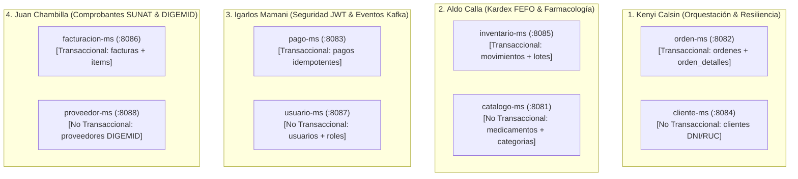
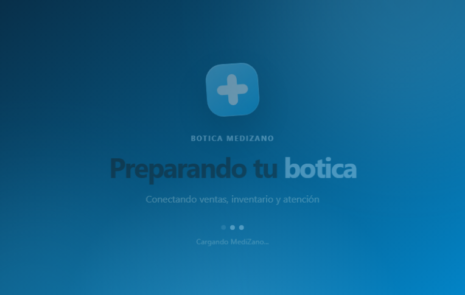
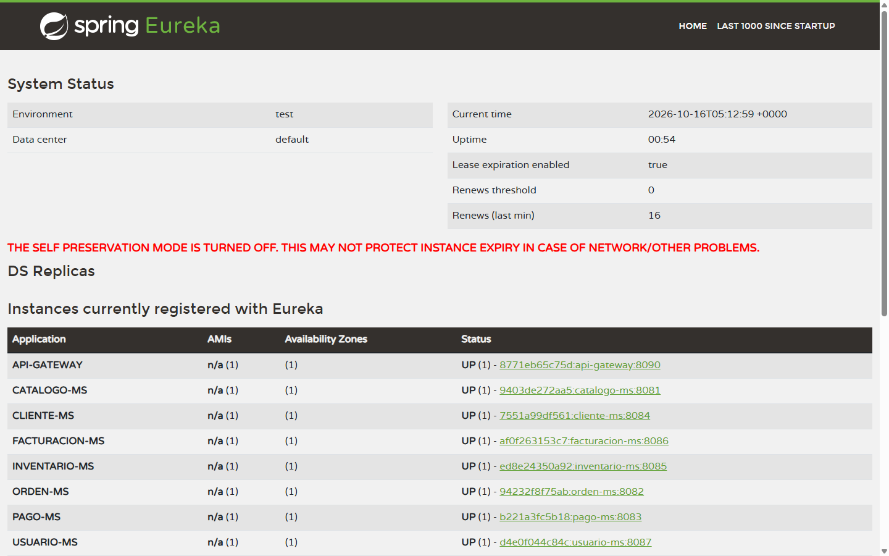
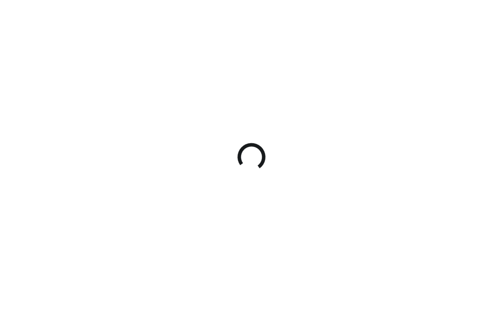
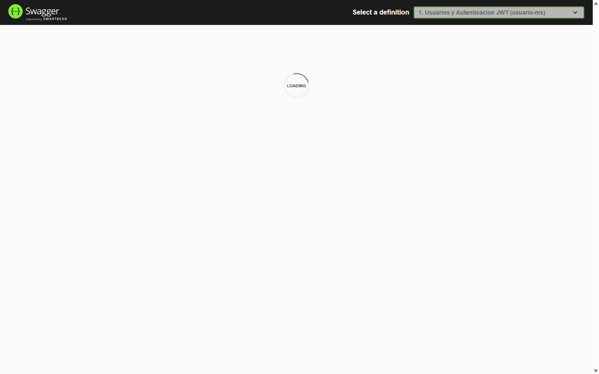
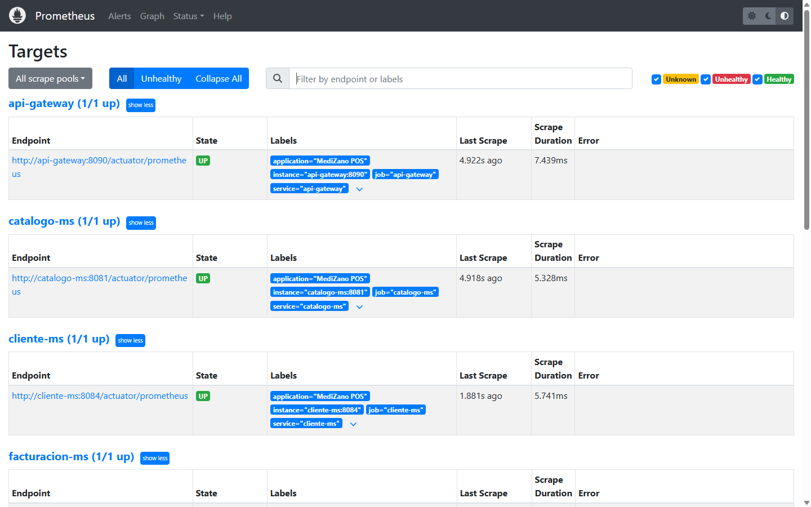
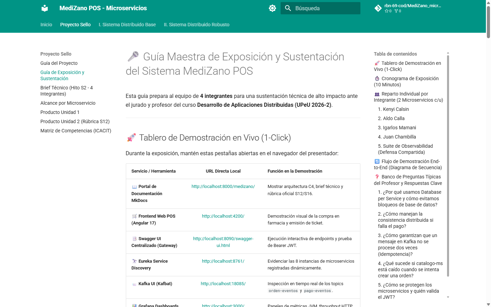
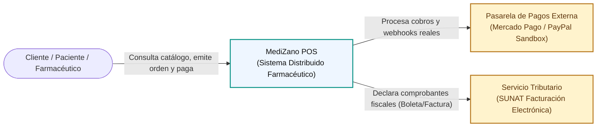
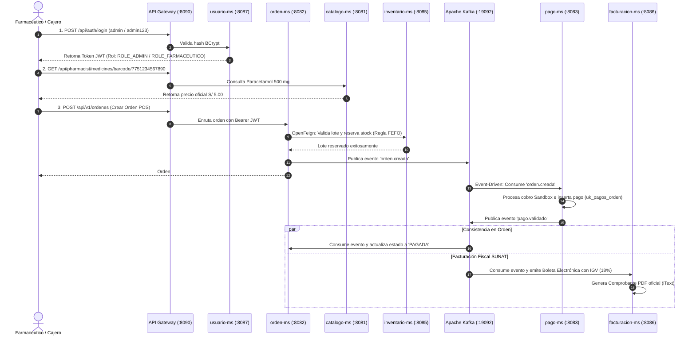

# MediZano POS - Sistema Distribuido Farmacéutico

> **Curso:** Desarrollo de Aplicaciones Distribuidas (DIST) · **Periodo:** 2026-2 · **Institución:** UPeU  
> **Repositorio Oficial:** [https://github.com/rbn-69-cod/MediZano_microservicios](https://github.com/rbn-69-cod/MediZano_microservicios)

---

> [!IMPORTANT]
> ### 🚀 Tablero de Enlaces Directos en Vivo (1-Click Demo)
> Durante la sustentación, abre directamente cualquiera de las interfaces operativas:
> 
> * 🛒 **Frontend Web POS (Angular 17):** [http://localhost:4200/](http://localhost:4200/)
> * 📑 **Swagger UI Centralizado (API Gateway):** [http://localhost:8090/swagger-ui.html](http://localhost:8090/swagger-ui.html)
> * 🔭 **Eureka Service Discovery:** [http://localhost:8761/](http://localhost:8761/)
> * 📨 **Kafka UI (Broker KRaft & Topics):** [http://localhost:18085/](http://localhost:18085/)
> * 📊 **Grafana Dashboards:** [http://localhost:3000/](http://localhost:3000/) *(Credenciales: `admin` / `admin`)*
> * 📈 **Prometheus Server:** [http://localhost:9090/](http://localhost:9090/)
> * 🎤 **Guía Detallada de Exposición (Minuto a Minuto):** [Abrir Guía de Sustentación](proyecto-sello/guia-exposicion.md)

---

## 🏛️ Repositorio Oficial GitHub & Estructura Distribuida

* 🐙 **URL de Origen:** [https://github.com/rbn-69-cod/MediZano_microservicios.git](https://github.com/rbn-69-cod/MediZano_microservicios.git)
* **Rama Principal:** `main` | **Arquitectura:** Clúster de Microservicios Contenerizados con Docker Compose


---

## 👥 Reparto Oficial por Integrante (4 Integrantes x 2 Microservicios)

Cumpliendo con la directiva de la cátedra (**1 microservicio Transaccional Cabecera-Detalle + 1 microservicio No Transaccional Catálogo/Maestro por estudiante**):



---

### 1️⃣ Integrante 1: Kenyi Calsin
**Rol:** Arquitectura de Orquestación de Pedidos y Resiliencia Síncrona.

* **Microservicio Transaccional:** `orden-ms` (Puerto `:8082` | BD: `medizano_ordenes_db`)
    * **Tablas implementadas:** `ordenes` (Cabecera: ID, cliente, método pago, estado, total) y `orden_detalles` (Detalle: ID, orden_id, medicamento_id, cantidad, precio, subtotal).
    * **Endpoints clave:** `POST /api/v1/ordenes` (Creación de venta POS), `GET /api/v1/ordenes/{id}`.
    * **Técnica defensiva:** Comunicación síncrona mediante **OpenFeign** hacia `catalogo-ms` e `inventario-ms` protegida con **Resilience4j Circuit Breaker y Timeouts (2s)**.
    * **Evento Kafka:** Emite el evento asíncrono `orden.creada` al topic `orden-eventos`.
* **Microservicio No Transaccional:** `cliente-ms` (Puerto `:8084` | BD: `medizano_clientes_db`)
    * **Tablas implementadas:** `clientes` (ID, tipo_persona, DNI, RUC, nombre_completo, teléfono, email, dirección).
    * **Endpoints clave:** `GET /api/v1/clientes/documento/{doc}`, `POST /api/v1/clientes`.
* **Qué responder ante el profesor:** *"Explico cómo `orden-ms` no hace JOINs con clientes ni medicamentos (Database per Service); valida los datos con OpenFeign y si el servicio catálogo falla, el Circuit Breaker de Resilience4j ejecuta el fallback sin tumbar la pasarela POS"*.

---

### 2️⃣ Integrante 2: Aldo Calla
**Rol:** Control de Inventario Kardex FEFO y Catálogo Farmacéutico.

* **Microservicio Transaccional:** `inventario-ms` (Puerto `:8085` | BD: `medizano_inventario_db`)
    * **Tablas implementadas:** `lotes` (lote, fecha_vencimiento, stock_actual, precio_compra) y `movimientos_inventario` (tipo: ENTRADA, SALIDA_VENTA, COMPENSACION, DEVOLUCION).
    * **Endpoints clave:** `POST /api/pharmacist/batches`, `GET /api/pharmacist/batches/medicine/{id}`, `POST /api/v1/inventario/reservar`.
    * **Técnica defensiva:** Algoritmo **FEFO (First Expired, First Out)** que selecciona automáticamente el lote con fecha de caducidad más cercana para la dispensación farmacéutica.
    * **Compensación Saga:** Endpoint de liberación y reposición de stock ante fallos de pago.
* **Microservicio No Transaccional:** `catalogo-ms` (Puerto `:8081` | BD: `medizano_catalogo_db`)
    * **Tablas implementadas:** `medicamentos` (nombre, principio activo, concentración, forma, código de barras) y `categorias` (Analgésicos, Antibióticos, etc.).
    * **Endpoints clave:** `GET /api/pharmacist/medicines`, `GET /api/pharmacist/medicines/barcode/{barcode}`.
* **Qué responder ante el profesor:** *"En una farmacia la regla crítica es FEFO, no FIFO. Si un lote vence antes, se descuenta primero. Si la orden se cancela, `inventario-ms` ejecuta una compensación restaurando el stock exacto al lote reservado"*.

---

### 3️⃣ Integrante 3: Igarlos Mamani
**Rol:** Seguridad Distribuida (JWT/RBAC), Pasarelas de Pago y Mensajería Kafka.

* **Microservicio Transaccional:** `pago-ms` (Puerto `:8083` | BD: `medizano_pagos_db`)
    * **Tablas implementadas:** `pagos` (ID, orden_id, transaction_id, gateway: PAYPAL/MERCADOPAGO, monto, estado).
    * **Endpoints clave:** `POST /api/v1/pagos/checkout`, `POST /api/v1/pagos/webhook/mercadopago`.
    * **Técnica defensiva:** **Consumidor Kafka Idempotente**. Protección con `CONSTRAINT uk_pagos_orden UNIQUE (orden_id)` para asegurar que ningún pedido se cobre dos veces ante reintentos de red.
    * **Evento Kafka:** Consume `orden.creada` y emite `pago.validado` o `pago.fallido`.
* **Microservicio No Transaccional:** `usuario-ms` (Puerto `:8087` | BD: `medizano_usuarios_db`)
    * **Tablas implementadas:** `usuarios` (username, password_hash BCrypt, email, activo) y `roles` (`ROLE_ADMIN`, `ROLE_FARMACEUTICO`, `ROLE_CLIENTE`).
    * **Endpoints clave:** `POST /api/auth/login`, `GET /api/admin/audit/all`.
* **Qué responder ante el profesor:** *"Demuestro que la seguridad no es solo de Gateway. Cada microservicio valida criptográficamente el JWT con su clave secreta y aplica `@PreAuthorize`. Además `pago-ms` tiene idempotencia garantizada por base de datos"*.

---

### 4️⃣ Integrante 4: Juan Chambilla
**Rol:** Facturación Electrónica Fiscal SUNAT y Gestión de Proveedores DIGEMID.

* **Microservicio Transaccional:** `facturacion-ms` (Puerto `:8086` | BD: `medizano_facturacion_db`)
    * **Tablas implementadas:** `facturas` (serie, correlativo, DNI/RUC, subtotal, IGV 18%, total, hash SUNAT) y `factura_items` (items facturados, descripción, IGV).
    * **Endpoints clave:** `POST /api/v1/facturas`, `GET /api/v1/facturas/{id}/pdf` (Generación de PDF con iText), `GET /api/v1/facturas/reportes/ventas`.
    * **Técnica defensiva:** Desacople por eventos: Al confirmarse el pago en Kafka, emite el comprobante electrónico fiscal con cálculo legal de IGV 18% y PDF descargable en tiempo real.
---

## 🏢 Directorio de Proveedores y Laboratorios Homologados (DIGEMID)

Gestionado por el microservicio **`proveedor-ms`** (Puerto `:8088` | Base de datos: `medizano_proveedores_db` | Responsable: **Juan Chambilla**), este módulo administra el padrón de laboratorios fabricantes y droguerías mayoristas autorizadas por **DIGEMID**:

| N° | RUC | Razón Social | Laboratorio / Marca | Registro DIGEMID | Dirección Fiscal | Teléfono | Correo de Contacto | Estado |
| :-: | :---: | :--- | :--- | :---: | :--- | :---: | :--- | :---: |
| **1** | `20100123456` | **LABORATORIOS PORTUGAL S.R.L.** | Portugal | `DIGEMID-LAB-00124` | Av. Manuel Muñoz Najar 412, Arequipa | `054-283920` | `ventas@portugal.pe` | **ACTIVO** |
| **2** | `20100234567` | **LABORATORIOS BAGO DEL PERU S.A.** | Bagó Perú | `DIGEMID-LAB-00215` | Av. Jorge Chávez 154, Miraflores, Lima | `01-2139000` | `contacto@bago.com.pe` | **ACTIVO** |
| **3** | `20100345678` | **MEDIFARMA S.A.** | Medifarma | `DIGEMID-LAB-00089` | Jr. Ecuador 787, Lima Cercado | `01-3304500` | `institucional@medifarma.com.pe` | **ACTIVO** |
| **4** | `20100456789` | **AC FARMA S.A.** | AC Farma | `DIGEMID-LAB-00342` | Calle El Retiro 185, Ate, Lima | `01-7195500` | `ventas@acfarma.com` | **ACTIVO** |
| **5** | `20100567890` | **GENFAR PERU S.A.** | Genfar | `DIGEMID-LAB-00411` | Av. Elmer Faucett 345, Callao | `01-5178900` | `atencion@genfar.com.pe` | **ACTIVO** |
| **6** | `20100678901` | **PFIZER S.A.** | Pfizer Perú | `DIGEMID-LAB-00055` | Av. Javier Prado Este 444, San Isidro | `01-6152000` | `pedidos@pfizer.com.pe` | **ACTIVO** |
| **7** | `20100789012` | **BAYER S.A.** | Bayer | `DIGEMID-LAB-00078` | Av. Paseo de la República 3074, San Isidro | `01-2113800` | `informes@bayer.com.pe` | **ACTIVO** |
| **8** | `20100890123` | **ROEMMERS S.A.** | Roemmers | `DIGEMID-LAB-00190` | Av. Faustino Sánchez Carrión 465, Magdalena | `01-4620020` | `ventas@roemmers.com.pe` | **ACTIVO** |
| **9** | `20100901234` | **FARMINDUSTRIA S.A.** | Farmindustria | `DIGEMID-LAB-00103` | Calle San Pedro 150, Chorrillos, Lima | `01-6187700` | `contacto@farmindustria.com.pe` | **ACTIVO** |
| **10** | `20101012345` | **HERSIL S.A. LABORATORIOS** | Hersil | `DIGEMID-LAB-00167` | Av. Los Frutales 220, Ate, Lima | `01-7132000` | `ventas@hersil.com.pe` | **ACTIVO** |
| **11** | `20101123456` | **LABORATORIOS LANSIER S.A.C.** | Lansier | `DIGEMID-LAB-00278` | Jr. Paruro 1401, Cercado de Lima | `01-2089200` | `servicio@lansier.com` | **ACTIVO** |
| **12** | `20101234567` | **QUIMICA SUIZA S.A.C.** | Química Suiza | `DIGEMID-DIS-00034` | Av. República de Panamá 2577, La Victoria | `01-2114000` | `pedidos@quimicasuiza.com` | **ACTIVO** |
| **13** | `20101345678` | **DROGUERIA LOS ANDES S.A.C.** | Los Andes | `DIGEMID-DIS-00056` | Calle Las Begonias 441, San Isidro | `01-4408900` | `info@losandes.com.pe` | **ACTIVO** |
| **14** | `20101456789` | **TECNOFARMA S.A.** | Tecnofarma | `DIGEMID-LAB-00389` | Av. El Derby 055, Surco, Lima | `01-6185000` | `contacto@tecnofarma.com.pe` | **ACTIVO** |
| **15** | `20101567890` | **LABORATORIOS SAVAL S.A.** | Saval Perú | `DIGEMID-LAB-00299` | Av. Canaval y Moreyra 425, San Isidro | `01-2223400` | `ventas@saval.com.pe` | **ACTIVO** |

> **Endpoints REST Implementados:**
> * `GET /api/v1/proveedores`: Lista de laboratorios activos.
> * `GET /api/v1/proveedores/ruc/{ruc}`: Búsqueda indexada por RUC.
> * `POST /api/v1/proveedores`: Registro homologado con validación de registro sanitario DIGEMID.

---

## 💊 Catálogo Farmacéutico Maestro (203 Medicamentos y Lotes FEFO)

Gestionado por **`catalogo-ms`** (`:8081` · Aldo Calla) e **`inventario-ms`** (`:8085` · Aldo Calla), el sistema cuenta con un catálogo industrial de **203 presentaciones farmacológicas activas** respaldadas por **203 lotes FEFO** y más de **35,500 unidades en inventario**:

### Distribución por Categorías Terapéuticas
| Categoría Farmacéutica | Principales Principios Activos y Medicamentos | Presentaciones | Requiere Receta |
| :--- | :--- | :--- | :---: |
| **Analgésicos y Antipiréticos** | Paracetamol, Metamizol (Antalgina), Tramadol, Clonixinato de Lisina, Aspirina | Tabletas 500mg/1g, Jarabes, Gotas, Inyectables | No / Sí (Opioides) |
| **Antiinflamatorios (AINEs)** | Ibuprofeno, Naproxeno, Diclofenaco Sódico/Potásico, Ketorolaco, Celecoxib, Etoricoxib | 400mg/600mg/800mg, Geles tópicos, Inyectables | No / Sí (Cox-2) |
| **Antibióticos y Antibacterianos** | Amoxicilina, Amoxicilina + Clavulánico, Azitromicina, Ciprofloxacino, Ceftriaxona, Claritromicina | 500mg/875mg, Suspensiones pediátricas, Frasco Viales | **Sí (Médica OBLIGATORIA)** |
| **Antihistamínicos y Antialérgicos** | Cetirizina, Loratadina, Desloratadina, Levocetirizina, Clorfenamina, Fexofenadina (Allegra) | Tabletas 10mg, Jarabes 60ml/100ml, Sprays Nasales | No |
| **Antigripales y Descongestionantes** | Panadol Antigripal (Día/Noche), Nastizol Compositum, Decongel, Afrin, Avamys | Cápsulas Blandas, Tabletas Masticables, Soluciones Nasales | No / Sí |
| **Gastrointestinales y Antiácidos** | Omeprazol, Esomeprazol, Lansoprazol, Bismutol, Mylanta, Simeticona (Gaseovet), Buscapina | Cápsulas 20mg/40mg, Suspensiones 360ml, Gotas, Grageas | No / Sí |
| **Cardiovasculares y Antihipertensivos** | Losartán, Enalapril, Amlodipino, Atenolol, Bisoprolol, Atorvastatina, Rosuvastatina, Metformina | Tabletas x 30 días, Dosis 10mg/20mg/50mg/100mg/850mg | **Sí (Crónicos)** |
| **Vitaminas y Suplementos** | Complejo B, Vitamina C (Redoxon 1g/2g), Vitamina D3, Sulfato Ferroso, Magnesol, Omega 3, Colágeno | Efervescentes, Cápsulas Blandas, Sobres, Polvo | No |
| **Dermatológicos y Tópicos** | Clotrimazol, Ketoconazol, Betametasona, Mupirocina (Bactroban), Barmicil, Terbinafina | Cremas Dérmicas 20g/30g/50g, Shampoos, Pomadas | No / Sí |
| **Respiratorios y Broncodilatadores** | Salbutamol, Bromuro de Ipratropio, Budesonida, Fluimucil (Acetilcisteína), Ambroxol | Inhaladores 200 dosis, Soluciones para Nebulizar, Sobres | **Sí (Inhalatoria)** |

### Muestra de Medicamentos de Alta Rotación en Base de Datos
| ID | Código de Barras | Medicamento | Concentración | Laboratorio | Precio Compra | Precio Venta | Lote FEFO | Stock Disponible | Vencimiento |
| :-: | :---: | :--- | :--- | :--- | :---: | :---: | :---: | :---: | :---: |
| **1** | `7751234567890` | **Paracetamol** | 500 mg Tableta | Portugal | S/ 2.00 | **S/ 5.00** | `LOT-PAR-2026-001` | **147 un.** | 2028-10-16 |
| **2** | `7759876543210` | **Amoxicilina** | 500 mg Cápsula | Bagó Perú | S/ 8.00 | **S/ 15.50** | `LOT-AMX-2026-002` | **100 un.** | 2028-10-16 |
| **3** | `7755554443332` | **Ibuprofeno** | 400 mg Tableta | Genfar | S/ 3.50 | **S/ 8.00** | `LOT-IBU-2026-003` | **120 un.** | 2028-10-16 |
| **4** | `7752000000000` | **Paracetamol** | 120 mg/5ml Jarabe | Portugal | S/ 1.50 | **S/ 3.50** | `LOT-2026-0004` | **118 un.** | 2027-05-28 |
| **10** | `7752000000006` | **Diclofenaco Sódico** | 75 mg/3ml Inyectable | AC Farma | S/ 2.75 | **S/ 6.60** | `LOT-2026-0010` | **220 un.** | 2028-11-28 |
| **25** | `7752000000021` | **Azitromicina** | 500 mg x 3 Tab. | Roemmers | S/ 8.80 | **S/ 22.00** | `LOT-2026-0025` | **175 un.** | 2028-02-28 |
| **40** | `7752000000036` | **Cetirizina** | 10 mg x 10 Tab. | Medifarma | S/ 2.20 | **S/ 5.50** | `LOT-2026-0040` | **230 un.** | 2027-05-28 |
| **55** | `7752000000051` | **Omeprazol** | 20 mg x 14 Cáp. | Farmindustria | S/ 2.75 | **S/ 6.60** | `LOT-2026-0055` | **185 un.** | 2028-08-28 |
| **70** | `7752000000066` | **Losartán Potásico** | 50 mg x 30 Tab. | Hersil | S/ 3.00 | **S/ 8.00** | `LOT-2026-0070` | **190 un.** | 2027-11-28 |
| **100** | `7752000000096` | **Complejo B** | Tabletas x 100 | Portugal | S/ 8.00 | **S/ 18.00** | `LOT-2026-0100` | **250 un.** | 2027-05-28 |
| **150** | `7752000000146` | **Metformina** | 850 mg x 30 Tab. | Bayer | S/ 3.60 | **S/ 10.20** | `LOT-2026-0150` | **200 un.** | 2027-07-28 |
| **200** | `7752000000196` | **Magnesol B6** | Cápsulas x 60 | Farmindustria | S/ 9.90 | **S/ 24.20** | `LOT-2026-0200` | **150 un.** | 2027-09-28 |

---

## 🔐 Directorio de Usuarios, Credenciales de Acceso y Matriz RBAC

Para acceder al sistema desde el cliente web ([http://localhost:4200/auth/login](http://localhost:4200/auth/login)) o consumir los endpoints vía API Gateway (`:8090`), se dispone de **7 cuentas pre-configuradas** con roles diferenciados:

| Usuario | Contraseña | Rol en Sistema | Correo Electrónico | Funcionalidad y Alcance en MediZano POS | Rutas Permitidas en Frontend |
| :--- | :--- | :--- | :--- | :--- | :--- |
| **`admin`** | `admin123` | `ADMIN` | `admin@medizano.pe` | **Acceso Total:** Auditoría global de accesos, gestión de usuarios, roles, métricas y configuración perimetral. | `/dashboard`, `/user-management`, `/user-activity`, `/login-history`, y todas las rutas. |
| **`cajero`** | `admin123` | `CASHIER` | `cajero@medizano.pe` | **Punto de Venta (POS):** Búsqueda de medicamentos por código de barras, emisión de órdenes, cobro con pasarelas (PayPal/Mercado Pago) y facturación. | `/dashboard`, `/billing` |
| **`inventario`** | `admin123` | `STOCK_MONITOR` | `inventario@medizano.pe` | **Control de Existencias:** Monitoreo de stock, visualización de lotes activos y control de vencimiento farmacéutico bajo regla FEFO. | `/dashboard`, `/inventory` |
| **`almacen`** | `admin123` | `STOCK_KEEPER` | `almacen@medizano.pe` | **Logística Farmacéutica:** Catálogo de medicamentos, registro de ingresos por compras a laboratorios y actualización de lotes. | `/dashboard`, `/medicines` |
| **`soporte`** | `admin123` | `CUSTOMER_SUPPORT` | `soporte@medizano.pe` | **Atención al Cliente:** Directorio de pacientes/clientes, consulta de recetas, historial de órdenes y registro de devoluciones/reembolsos. | `/dashboard`, `/returns` |
| **`analista`** | `admin123` | `ANALYST` | `analista@medizano.pe` | **Reportes & Finanzas:** Reportes consolidados de ventas, conciliación de caja, declaraciones tributarias SUNAT y analítica. | `/dashboard`, `/reports` |
| **`gerente`** | `admin123` | `MANAGER` | `gerente@medizano.pe` | **Supervisión Gerencial:** Aprobación de devoluciones, auditoría gerencial de arqueo de caja y contratos con proveedores DIGEMID. | `/dashboard`, `/purchase-history`, `/reports` |

> [!NOTE]
> ### 🛡️ Arquitectura de Seguridad (Defense in Depth)
> 1. **Cifrado de Credenciales:** Todas las contraseñas se almacenan como hashes irreversibles **BCrypt** con 10 rondas de salting en `medizano_usuarios_db`.
> 2. **Token JWT Asimétrico:** Al iniciar sesión en `POST /api/auth/login`, `usuario-ms` emite un token **JSON Web Token (HMAC-SHA384)** que transporta el claim `role`, nombre de usuario y expiración.
> 3. **Validación Reactiva en Gateway:** El `api-gateway` (`:8090`) intercepta cada petición HTTP, verifica la firma criptográfica y el vencimiento antes de enrutar el tráfico hacia la red interna.
> 4. **Protección de Rutas en Angular (Guards):** El cliente SPA cuenta con `AuthGuard` (comprueba sesión activa en `sessionStorage`) y `RoleGuard` (verifica que el rol del usuario figure en la lista autorizada de la ruta).
> 5. **Control Granular en Backend:** Cada microservicio evalúa `@PreAuthorize("hasRole('ROLE_...')")` a nivel de método REST.

### Pantalla de Inicio de Sesión (Login POS)


---

## 📸 Galería Visual de Evidencias en Vivo

### 1. Sistema Web POS Farmacéutico (Frontend Angular 17 sobre Nginx)
Interfaz completa de dispensación, búsqueda de medicamentos por código de barras, selección de paciente y cobro digital:


---

### 2. Service Discovery Dinámico (Netflix Eureka Server)
Las 8 instancias de microservicios registradas dinámicamente con sus IPs y puertos internos:



---

### 3. Broker Apache Kafka & Consola Kafka UI
Topics de mensajería asíncrona (`orden-eventos`, `pago-eventos`, `inventario-eventos`, `factura-eventos`) con particiones KRaft y métricas de mensajes:



---

### 4. Suite de Observabilidad Unificada (Grafana)
Tableros de métricas JVM, throughput de peticiones HTTP, estado de base de datos y trazabilidad de logs con `traceId`:


---

### 5. API Gateway Centralizado & Swagger UI Interactivo
Punto único perimetral con documentación interactiva OpenAPI 3.0 de todos los microservicios:



---

### 6. Servidor de Series Temporales Prometheus
Scraping continuo de métricas en los endpoints `/actuator/prometheus` de cada contenedor:



---

### 7. Portal de Documentación Oficial de Sustentación (MkDocs Material)
Sitio web local con el sílabo, arquitectura C4, brief técnico y rúbrica oficial de sustentación:

---

## 🏛️ Arquitectura del Sistema (Diagramas C4)

### C4 Nivel 1: Contexto del Sistema (System Context)


---

### C4 Nivel 2: Diagrama de Contenedores (Container Diagram)
```mermaid
flowchart TD
    ClienteWeb["Frontend Angular 17 (Nginx :4200)"]
    
    subgraph Infraestructura["Infraestructura Spring Cloud"]
        Gateway["API Gateway (:8090)"]
        Eureka["Eureka Discovery (:8761)"]
    end

    subgraph Seguridad["Seguridad & Identidad"]
        UsuarioMS["usuario-ms (:8087)\n(Igarlos Mamani)"]
    end

    subgraph MicroserviciosNegocio["Microservicios de Negocio"]
        CatalogoMS["catalogo-ms (:8081)\n(Aldo Calla)"]
        ClienteMS["cliente-ms (:8084)\n(Kenyi Calsin)"]
        OrdenMS["orden-ms (:8082)\n(Kenyi Calsin)"]
        InventarioMS["inventario-ms (:8085)\n(Aldo Calla)"]
        PagoMS["pago-ms (:8083)\n(Igarlos Mamani)"]
        FacturacionMS["facturacion-ms (:8086)\n(Juan Chambilla)"]
        ProveedorMS["proveedor-ms (:8088)\n(Juan Chambilla)"]
    end

    subgraph EventBroker["Mensajería Asíncrona"]
        Kafka["Apache Kafka (:19092)\nTopics: orden-eventos, pago-eventos"]
        KafkaUI["Kafka UI (:18085)"]
    end

    subgraph Observabilidad["Suite de Observabilidad"]
        Prometheus["Prometheus (:9090)"]
        Loki["Loki (:3100)"]
        Grafana["Grafana Dashboards (:3000)"]
    end

    ClienteWeb -->|HTTP /api/| Gateway
    Gateway -->|Enruta vía Eureka| UsuarioMS & CatalogoMS & ClienteMS & OrdenMS & PagoMS & InventarioMS & FacturacionMS & ProveedorMS

    OrdenMS -->|OpenFeign Resiliente| CatalogoMS & InventarioMS
    OrdenMS -->|Publica orden.creada| Kafka
    Kafka -->|Consume orden.creada| PagoMS
    PagoMS -->|Publica pago.validado / pago.fallido| Kafka
    Kafka -->|Consume pago.validado| OrdenMS & FacturacionMS
    Kafka -->|Consume pago.fallido (Compensación Saga)| OrdenMS

    MicroserviciosNegocio -.->|Métricas Actuator| Prometheus
    MicroserviciosNegocio -.->|Logs con TraceID| Loki
    Prometheus & Loki -.-> Grafana
```

---

## 🔄 Flujo de Demostración End-to-End en Exposición



---

## 🛠️ Comandos de Comprobación en Vivo para el Jurado

```bash
# 1. Verificar estado saludable de los 18 contenedores Docker
docker ps --format "table {{.Names}}\t{{.Status}}\t{{.Ports}}"

# 2. Comprobar las 8 bases de datos independientes en PostgreSQL
docker exec -it medizano-postgres psql -U postgres -d postgres -c "\l"

# 3. Listar topics en el broker Apache Kafka
docker exec -it medizano-kafka /opt/kafka/bin/kafka-topics.sh --bootstrap-server localhost:9092 --list

# 4. Ejecutar auditoría automatizada integral (10/10 OK)
node run_e2e_audit.js
```
