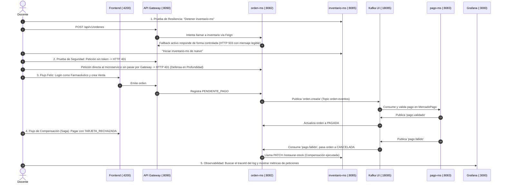

# Producto de Unidad 2: Sistema Distribuido Robusto

**MediZano POS - Hito de Evaluación S12 (CE023 Nivel 3)**

## 1. Producto Entregable
**Sistema distribuido seguro, resiliente, consistente, observable e integrado con cliente frontend.**

Implementa comunicación síncrona tolerante a fallos, seguridad perimetral y distribuida en profundidad, mensajería asíncrona desacoplada con Kafka, consistencia eventual con Saga Coreografiada e idempotencia, observabilidad centralizada (métricas, logs y dashboards) e integración completa con cliente web SPA Angular a través del API Gateway.

---

## 2. Alcance de Capacidades por Sesión (MediZano POS)

| Sesión | Capacidad que agrega | Implementación Real en MediZano POS |
| :--- | :--- | :--- |
| **S6** | **Comunicación síncrona resiliente** (Respuesta controlada ante fallos). | `orden-ms` consulta y reserva existencias en `catalogo-ms` e `inventario-ms` vía **Spring Cloud OpenFeign** con **Resilience4j** (Timeout de 2s, 3 reintentos y *Fallback* controlado ante caída de instancia). |
| **S7 / S7b** | **Seguridad distribuida y protección de rutas**. | Autenticación basada en **JWT asimétrico / Keycloak** con roles RBAC (`ROLE_ADMIN`, `ROLE_FARMACEUTICO`, `ROLE_CLIENTE`). Cada microservicio valida la firma del token de forma autónoma (Defensa en profundidad). |
| **S8** | **Mensajería asíncrona entre servicios desacoplados**. | Al crearse la orden, `orden-ms` publica el evento de negocio `orden.creada` al topic `orden-eventos` de **Apache Kafka**, con clave `ordenId` para ordenamiento por partición. `pago-ms` lo consume sin acoplamiento HTTP directo. |
| **S9** | **Consistencia eventual, compensación e idempotencia**. | Patrón **Saga Coreografiada**. Si el pago es aprobado, `pago-ms` emite `pago.validado` y la orden pasa a `PAGADA`. Si el cobro falla (`metodoPago: "TARJETA_RECHAZADA"`), `pago-ms` emite `pago.fallido`, `orden-ms` pasa a `CANCELADA` y ejecuta compensación restaurando el stock en `inventario-ms`. Consumidor protegido con clave única `uk_pagos_orden`. |
| **S10** | **Observabilidad operacional centralizada**. | Trazabilidad distribuida mediante cabecera `X-Trace-ID` (MDC `traceId`) inyectada en Gateway y propagada a logs. Métricas de negocio expuestas por **Actuator + Prometheus** y recolectadas junto a logs en **Loki / Alloy**, visualizadas en dashboards unificados en **Grafana** (:3000). |
| **S11** | **Integración con cliente frontend**. | SPA **Angular 17** contenerizada sobre Nginx (:4200) que consume la API completa **únicamente a través del Gateway** (:8090). Implementa guardias de ruta (`canActivate`), gestión de sesión y pantalla POS de cobro y ventas. |
| **S12** | **Integración y Sustentación Técnica**. | Ensamblado integral de los 8 microservicios asignados a los 4 integrantes, defendido mediante pitch, demo técnica en vivo y respuestas teóricas individuales. |

### Asignación de Microservicios por Integrante para la Sustentación S12

| Integrante | Rol en la Demo | Microservicio Transaccional | Microservicio No Transaccional |
| :--- | :--- | :--- | :--- |
| **Kenyi Calsin** | Demo de Órdenes y Resiliencia Feign | **`orden-ms`** (`:8082`) | **`cliente-ms`** (`:8084`) |
| **Aldo Calla** | Demo de Kardex, FEFO y Catálogo | **`inventario-ms`** (`:8085`) | **`catalogo-ms`** (`:8081`) |
| **Igarlos Mamani** | Demo de Pasarela Real y Eventos Kafka | **`pago-ms`** (`:8083`) | **`usuario-ms`** (`:8087`) |
| **Juan Chambilla** | Demo de Facturación SUNAT y Proveedores | **`facturacion-ms`** (`:8086`) | **`proveedor-ms`** (`:8088`) |

---

## 3. Rúbrica Oficial de Evaluación (Unidad II)

| Criterio | Peso | Competencia | Nivel A (20 pts) | Nivel B (15 pts) | Nivel C (10 pts) | Nivel D (5 pts) |
| :--- | :---: | :---: | :--- | :--- | :--- | :--- |
| **1. Comunicación síncrona resiliente** | 12% | CE023-N3 | Timeout, reintentos y *fallback* verificados en vivo provocando la caída forzada de una instancia. | Mecanismo presente, verificado parcialmente. | Definido en código, sin verificación ante fallo real. | No implementa respuesta controlada ante fallos. |
| **2. Seguridad distribuida y rutas** | 16% | CE023-N3 | Autenticación y autorización verificadas en todos los microservicios de forma independiente, no solo en Gateway. | Seguridad verificada en la mayoría de servicios. | Seguridad presente solo en el Gateway. | No implementa seguridad distribuida. |
| **3. Mensajería asíncrona desacoplada** | 16% | CE023-N3 | Evento `orden.creada` publicado y consumido vía Kafka, con servicios probados de forma autónoma. | Mensajería funcional, con acoplamiento parcial. | Definida en código, sin verificación de desacople. | No implementa mensajería asíncrona. |
| **4. Consistencia, compensación e idempotencia** | 16% | CE023-N3 | Saga probada con fallo forzado (compensación de stock) y reprocesamiento de evento duplicado sin inconsistencia. | Consistencia verificada parcialmente (solo compensación o solo idempotencia). | Mencionada conceptualmente sin prueba real. | No evidencia consistencia distribuida. |
| **5. Observabilidad y diagnóstico** | 12% | CE023-N3 | Panel de Grafana operativo correlacionando métricas y logs con `traceId` entre microservicios ante una petición. | Panel operativo con correlación parcial. | Métricas o logs presentes sin panel ni correlación. | No presenta observabilidad verificable. |
| **6. Cliente frontend integrado** | 8% | CE023-N3 | Cliente Angular funcional consumiendo el sistema 100% vía Gateway, con sesión y rutas protegidas por rol. | Cliente funcional con llamadas directas fuera del Gateway o protección parcial. | Cliente parcialmente integrado. | No presenta frontend integrado. |
| **7. Sustentación técnica individual** | 20% | CG | Sustenta con solvencia, claridad y precisión técnica su aporte individual (sus 2 microservicios) y responde preguntas. | Sustenta con solvencia, con detalles menores en orden o precisión. | Sustenta con dificultad y precisión insuficiente. | No sustenta adecuadamente ni demuestra aporte propio. |

$$\text{Nota Final} = \sum \left( \frac{\text{Peso} \times \text{Puntos}}{100} \right)$$

---

## 4. Secuencia Oficial para la Demo Técnica en Vivo (S12)

Para asegurar la máxima nota (20 / Nivel A), el equipo debe seguir esta secuencia exacta durante los 8 minutos de demo:

